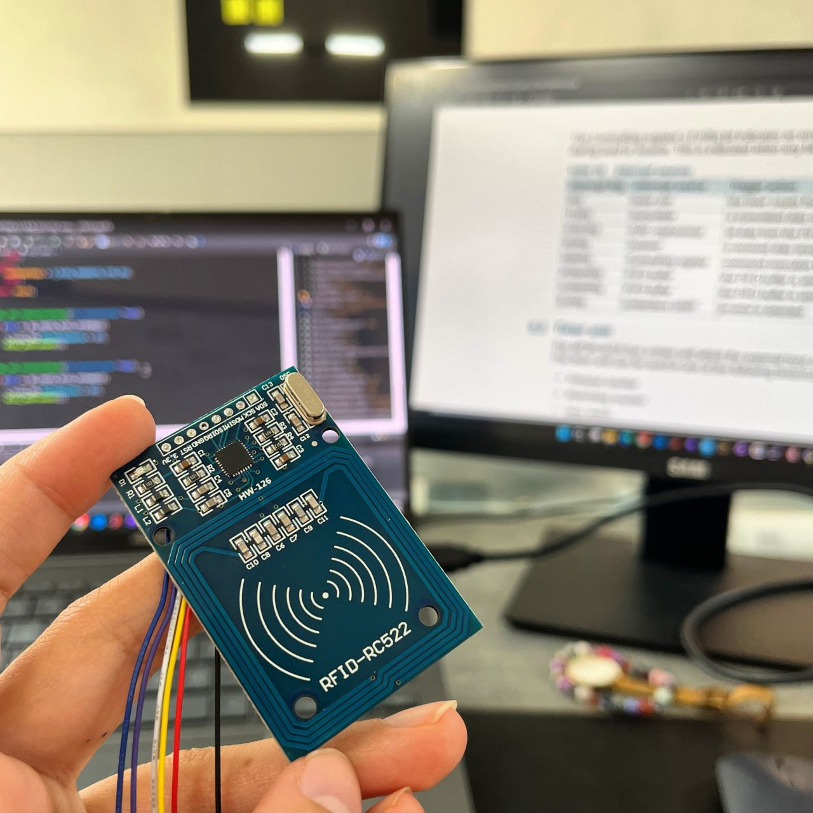

# STM32 RC522 Driver (SPI DMA, Non-Blocking)

A driver for the MFRC522 (RC522) RFID reader for STM32 HAL projects. After a short blocking init, it reads cards with **SPI DMA** through a **non-blocking state machine**: `RC522_run()` does one small step per call and returns at once, so your main loop keeps running while the reader looks for cards.

It was developed on an STM32F103C8 ("Blue Pill") in STM32CubeIDE.

<p align="center">
  
</p>

## Files

```
Inc/rc522.h    driver header (register map, configuration, API)
Src/rc522.c    driver source
Src/main.c     example: init, run in the loop, print the card ID
```

To use the driver, copy `rc522.h` and `rc522.c` into your project. `main.c` shows how to call them.

## Wiring

The RC522 module runs on **3.3 V only**.

| RC522 pin | STM32F103 pin | Notes |
|---|---|---|
| SDA (SS) | PA5 | Chip select (GPIO output) |
| SCK | PB13 | SPI2_SCK |
| MOSI | PB15 | SPI2_MOSI |
| MISO | PB14 | SPI2_MISO |
| RST | PA7 | Reset (GPIO output) |
| IRQ | not connected | |
| GND | GND | |
| 3.3V | 3.3V | |

## Setup in STM32CubeIDE

### 1. Configure the peripherals in CubeMX (`.ioc`)

**SPI2**: Mode *Full-Duplex Master*, Hardware NSS Signal *Disable*.

| Parameter | Value |
|---|---|
| Data size | 8 bits |
| First bit | MSB first |
| Clock polarity (CPOL) | Low |
| Clock phase (CPHA) | 1 Edge |
| Baud rate | 10 Mbit/s or less (MFRC522 limit). Prescaler 16 at 72 MHz gives 2.25 Mbit/s |

**SPI2 → DMA Settings**: add both requests.

| Request | Direction | Mode | Data width |
|---|---|---|---|
| SPI2_RX | Peripheral to Memory | Normal | Byte |
| SPI2_TX | Memory to Peripheral | Normal | Byte |

**NVIC**: the DMA1 channel 4 and channel 5 interrupts must be enabled (CubeMX enables them when you add the DMA requests).

**GPIO**:

| Pin | Mode | User label |
|---|---|---|
| PA5 | GPIO_Output | `MFRC522_CS` |
| PA7 | GPIO_Output | `MFRC522_RST` |

The `MFRC522_RST` label matters: the driver uses `MFRC522_RST_GPIO_Port` and `MFRC522_RST_Pin`, which CubeMX generates in `main.h` from that label.

**USART2** (optional, only for printing the card ID as in `main.c`): *Asynchronous*, 115200 baud, 8N1. TX is PA2.

Generate the code.

### 2. Add the driver files

- Copy `rc522.h` into `Core/Inc`.
- Copy `rc522.c` into `Core/Src`.

Both folders are already on the project's include and source paths, and CubeMX does not overwrite them when you regenerate code.

### 3. Call `RC522_tick()` every millisecond

The driver's timeouts count in ticks of `RC522_tick()`, so it must be called every 1 ms. Add it to the SysTick handler in `Core/Src/stm32f1xx_it.c`:

```c
/* USER CODE BEGIN Includes */
#include "rc522.h"
/* USER CODE END Includes */

...

void SysTick_Handler(void)
{
  /* USER CODE BEGIN SysTick_IRQn 0 */

  /* USER CODE END SysTick_IRQn 0 */
  HAL_IncTick();
  /* USER CODE BEGIN SysTick_IRQn 1 */
  RC522_tick();
  /* USER CODE END SysTick_IRQn 1 */
}
```

### 4. Init, then run in the main loop

In `main.c` (see [Src/main.c](Src/main.c)):

```c
/* USER CODE BEGIN Includes */
#include <stdio.h>
#include "rc522.h"
/* USER CODE END Includes */

...

  /* USER CODE BEGIN 2 */
  RC522_init();             /* load the default configuration */
  RC522_startDetection();   /* reset and initialize the module (blocking, a few ms) */
  /* USER CODE END 2 */

  while (1)
  {
    /* USER CODE BEGIN 3 */
    RC522_run();            /* non-blocking: call it on every loop iteration */

    if (s_rc522.s_status.s_IDStatus.isUnreadWaiting)
    {
      s_rc522.s_status.s_IDStatus.isUnreadWaiting = RESET;

      char msg[40];
      int len = snprintf(msg, sizeof(msg), "Card ID: %02X %02X %02X %02X\r\n",
          s_rc522.s_status.s_IDStatus.cardID[0], s_rc522.s_status.s_IDStatus.cardID[1],
          s_rc522.s_status.s_IDStatus.cardID[2], s_rc522.s_status.s_IDStatus.cardID[3]);
      HAL_UART_Transmit(&huart2, (uint8_t *)msg, (uint16_t)len, 100);
    }
  }
  /* USER CODE END 3 */
```

`RC522_init()` and `RC522_startDetection()` must come after `MX_GPIO_Init()`, `MX_DMA_Init()` and `MX_SPI2_Init()`.

## How it works

1. **Init (blocking).** `RC522_startDetection()` releases the RST pin, waits 2 ms, and calls `MFRC522_Init()`. That function resets the chip, sets up its timer and modulation, and turns the antenna on, using blocking `HAL_SPI_TransmitReceive()`.
2. **Detection (non-blocking).** From then on, `RC522_run()` drives the read state machine. Every register access is an SPI DMA transfer: one call starts the transfer, the DMA complete interrupt raises CS and sets a flag, and a later call continues. Each pass finds the card (REQA), then reads its ID (anticollision) and checks the ID's BCC byte.
3. **Validation.** A card is accepted once its ID has been confirmed more than `M_RC522_VALIDATION_TRYCOUNT` times (default 5). The driver then:
   - copies the ID to `s_rc522.s_status.s_IDStatus.cardID`,
   - sets `isIDValid`,
   - sets `isUnreadWaiting`, which your code reads and clears.

   After `M_RC522_VALIDATION_TIMEOUT` ms (default 2000), `isIDValid` is cleared and detection starts again.

## Reading the result

All state is in the global `s_rc522` structure:

| Field | Meaning |
|---|---|
| `s_rc522.s_status.s_IDStatus.isUnreadWaiting` | Set when a new card ID is available. Clear it after reading |
| `s_rc522.s_status.s_IDStatus.cardID[0..3]` | The 4-byte card UID (`cardID[4]` is the BCC check byte) |
| `s_rc522.s_status.s_IDStatus.isIDValid` | Set while the last ID is considered valid |
| `s_rc522.s_status.s_detection.isInitialized` | Set after `RC522_startDetection()` initialized the module |
| `s_rc522.s_status.s_detection.isModuleOn` | Set while detection is running |

## Configuration

| What | Where | Default |
|---|---|---|
| SPI handle for DMA transfers | `M_CONFIG_RC522_SPIHANDLE` in `rc522.c` | `hspi2` |
| SPI handle for the blocking init | `HSPI_INSTANCE` and `extern ... hspi2` in `rc522.h` | `&hspi2` |
| Chip-select pin | `MFRC522_CS_PORT` / `MFRC522_CS_PIN` in `rc522.h` | `GPIOA` / `GPIO_PIN_5` |
| Reset pin | CubeMX label `MFRC522_RST` (in `main.h`) | PA7 |
| Confirmations before a card is accepted | `M_RC522_VALIDATION_TRYCOUNT` in `rc522.c` | 5 |
| Time a validated ID stays valid | `M_RC522_VALIDATION_TIMEOUT` in `rc522.c` (ms) | 2000 |

To use another SPI instance, change both SPI settings. To use another CS pin, change the two CS defines.

## Notes

- **HAL callbacks.** The driver defines `HAL_SPI_TxCpltCallback()` and `HAL_SPI_TxRxCpltCallback()` itself, in `rc522.c`. If your project has other SPI devices that use these callbacks, merge them into the ones in `rc522.c`; defining them twice causes a "multiple definition" link error.
- **One reader.** The driver keeps its state in globals and supports one RC522.
- **UID size.** The card ID is read at cascade level 1, which gives the 4-byte UIDs of MIFARE Classic cards.
- **Other STM32 families.** `rc522.c` includes `main.h`, which brings in your family's HAL header, so the driver is not tied to the F1. Configure SPI, DMA and the pins as above for your board.

## License

MIT License. See [LICENSE](LICENSE).
